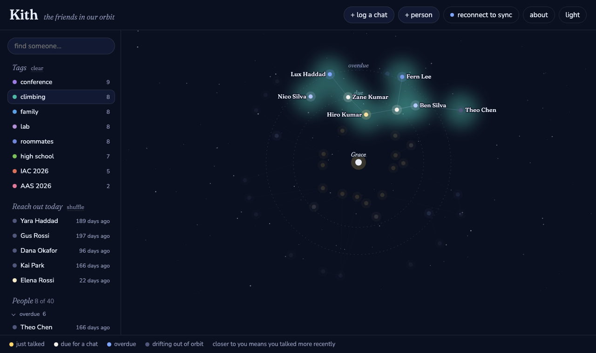

# Kith

*The friends in our orbit.*

Kith is a small website for keeping track of the people you know. Everyone sits in a sky around
you: the closer someone is, the more recently you talked, and when it has been longer than you
meant, they drift outward and fade, and Kith suggests you reach out.



**Use it:** <https://gkim65.github.io/kith/>

## What it does

- **Your sky.** You are the star in the middle. Each person orbits at a distance set by how long it
  has been since you talked, relative to how often you want to check in with them (their *check-in
  cadence*, e.g. every 2 weeks or every 3 months). Colour shows the same thing: gold for just
  talked, white for due, blue for overdue, faint for drifting out of orbit.
- **Reach out today.** Five suggestions each day, mostly people who have drifted, plus one who is
  nearly due. *Shuffle* picks again.
- **Chats.** Log a conversation with one or more people and a note. Type `@` to mention someone.
  Saving moves "last talked" forward for everyone in the chat.
- **Connections.** Link people ("introduced by", "roommates", …), shown as lines. People in the
  same chat, or mentioned in one, are joined by fainter dotted lines.
- **Tags and search.** Tag people (several each), light up one or more tags to see those groups
  glow, and search names, tags, notes and chat notes.

## Your data and privacy

- Your people are stored in **a Google Sheet in your own Google Drive**, and in your browser so the
  site works offline. There is no Kith server, no database, and no analytics.
- Kith asks Google only for the `drive.file` permission, which lets it open **only the one sheet it
  created**, nothing else in your Drive. It never shares that sheet.
- The sign-in token is kept in the open page's memory only and expires after about an hour.
- Everything you type is shown as plain text, never run as code. The page only loads code from
  itself, cdnjs (d3, checked against a fixed hash) and Google's sign-in script.

### How syncing keeps data safe

Every change is saved in your browser first. Syncing then reads the sheet, merges it with your
browser's copy, and writes the result back in a single request. The merge compares both sides with
the last version they agreed on, so changes made in the sheet by hand, in another browser, or here
are all kept. When the same thing was changed differently in two places, the version not kept is
added to a **Backups** tab in the sheet. A sync that would remove more than half your people stops
and asks first. Google Sheets' own version history (File > Version history) is a final safety net.

You can edit the sheet directly. Columns are matched by their headers, columns you add yourself
(say, `birthday`) are kept, and rows you type without an id are given one.

## Running your own copy

Kith is plain HTML, CSS and JavaScript with no build step. To host your own copy you need your own
Google OAuth client:

1. In [Google Cloud Console](https://console.cloud.google.com/), create a project.
2. Under **APIs & Services > Library**, enable the **Google Drive API** and the **Google Sheets API**.
3. Set up the **OAuth consent screen**. While the app is in *Testing* mode, only the Google
   accounts you add as test users can sign in.
4. Under **APIs & Services > Credentials**, create an **OAuth client ID** of type *Web
   application*, and add the address you will serve Kith from under **Authorized JavaScript
   origins** (for example `http://localhost:8765` and `https://<you>.github.io`).
5. Put your client ID in `CLIENT_ID` at the top of [js/google.js](js/google.js).

To run it locally:

```sh
python3 -m http.server 8765
```

then open <http://localhost:8765> (use `localhost`, not `127.0.0.1`: Google treats them as
different addresses). Browsers cache the JavaScript files, so after changing code use a hard reload
(Cmd+Shift+R).

## Files

| Path | What it holds |
|---|---|
| `index.html` | page layout, dialogs, security policy |
| `css/style.css` | light and dark themes, layout, phone layout |
| `js/main.js` | wires everything together |
| `js/graph.js` | the sky: orbits, stars, labels, camera |
| `js/data.js` | recency, search, and "reach out today" picks |
| `js/store.js` | saving in the browser |
| `js/sync.js` | the three-way merge and sync loop |
| `js/sheet.js` | reading and writing the Google Sheet |
| `js/google.js` | Google sign-in |
| `js/editor.js`, `js/logs.js` | the person editor and the chat form |
| `js/ui.js`, `js/html.js` | sidebar, panel, dialogs, shared helpers |
| `js/sample.js` | the sample people shown behind the sign-in screen |

## Credits

Made by [Grace](https://gkim65.github.io) with help from Claude. Uses [d3](https://d3js.org)
and the Fraunces and Nunito typefaces from Google Fonts.
